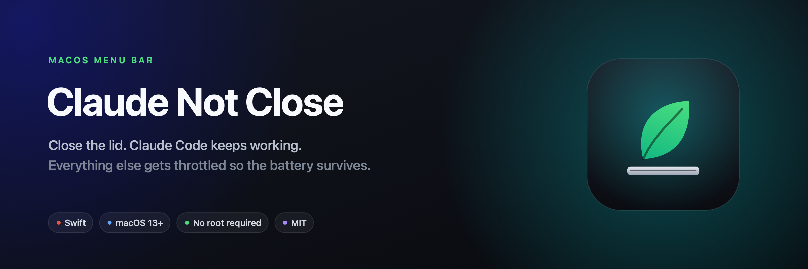
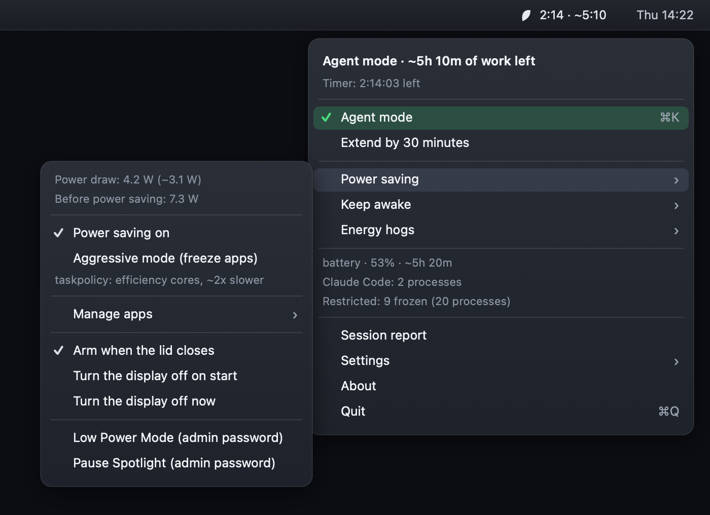

<p align="center">
  
</p>

<p align="center">
  <strong>Keep your MacBook awake with the lid closed — and stop everything else from draining the battery.</strong><br>
  A tiny macOS menu bar app for long Claude Code / AI-agent runs.
</p>

<p align="center">
  
  
  
  
</p>

---

Start a long agent run, shut the lid, walk away. The Mac stays awake, the agent keeps
working, and every app it doesn't need gets pushed onto the efficiency cores or frozen
outright — so the session doesn't eat your whole battery.

## Install

```bash
git clone https://github.com/MichalKaronczyk/macbook-keep-awake-lid-closed-.git
cd macbook-keep-awake-lid-closed-
./install.sh
```

Builds, copies to `/Applications`, launches. For autostart: **Settings → Launch at login**.

## What you get



- **Agent mode** (`⌘K`, or ⌥-click the icon) — keeps the Mac awake *and* throttles
  everything outside the allowlist, in one switch.
- **Time left, up front** — the headline tells you roughly how long you can keep
  working. Real watts, read from the battery controller, sit one level down under
  **Power saving**, next to the before/after comparison where the number means something.
- **Auto on lid close** — arms itself when the display sleeps, restores instantly on wake.
- **Auto with Claude Code** — holds the Mac awake while a `claude` process is alive,
  with a configurable grace period between prompts.
- **Energy hogs** — top CPU apps with their helper processes rolled up; one click freezes one.
- **Battery guard** — below your threshold it releases the hold *and* restores every app.

<br clear="right">

## How it saves battery

| Mode | Mechanism | Effect |
|---|---|---|
| **Gentle** (default) | `taskpolicy -b` → darwinbg | App moves to the efficiency cores + I/O throttling. A CPU-bound task measured ~**2× slower**. Still running, just cheap. |
| **Aggressive** | `SIGSTOP` | App frozen completely, zero CPU. Resumed with `SIGCONT` on exit. |

Both are fully reversible and need no root.

It covers **Electron helper processes** too — Slack, Cursor, VS Code and Discord keep
all their CPU in helpers that aren't visible as `NSRunningApplication`, so the app walks
the whole process tree. Terminals, editors, IDEs, Xcode, Docker and browsers are
protected by default; anything can be overridden per app.

## One macOS limitation

- **On AC power** — the assertions are enough. Close the lid, the Mac keeps working.
- **On battery** — macOS sleeps anyway, no matter what any app asserts. Wi-Fi goes down
  with it, so a running agent dies with `API Error: Connection closed mid-response`.

The only thing that prevents it is forced mode (`pmset -a disablesleep 1`, needs root)
under **Keep awake → Force on battery too**. Starting agent mode on battery offers to
turn it on, and if the Mac ever sleeps behind your back you get a notification saying
why. If anything gets stuck: `sudo pmset -a disablesleep 0`.

## Safety

A frozen process nobody resumes is a hung app. So: state is written to disk on every
change, anything left over from a crash is resumed at launch, restore runs from both
`applicationWillTerminate` and the SIGTERM/SIGINT/SIGHUP handlers, and `SIGSTOP` is
opt-in. Finder, Dock, Control Center and friends are never touched.

## Uninstall

```bash
pkill -x ClaudeNotClose
sudo pmset -a disablesleep 0    # if forced mode was on
sudo pmset -a lowpowermode 0    # if Low Power Mode was on
sudo mdutil -a -i on            # if Spotlight was paused
rm -rf "/Applications/Claude Not Close.app" ~/Library/Application\ Support/ClaudeNotClose
defaults delete eu.rynex-system.ClaudeNotClose
```

---

**[How it works →](docs/how-it-works.md)**

By [@MichalKaronczyk](https://github.com/MichalKaronczyk). Free to use, modify and
share — including at work. Selling it is not allowed; see [LICENSE](LICENSE).
Not affiliated with Anthropic.
